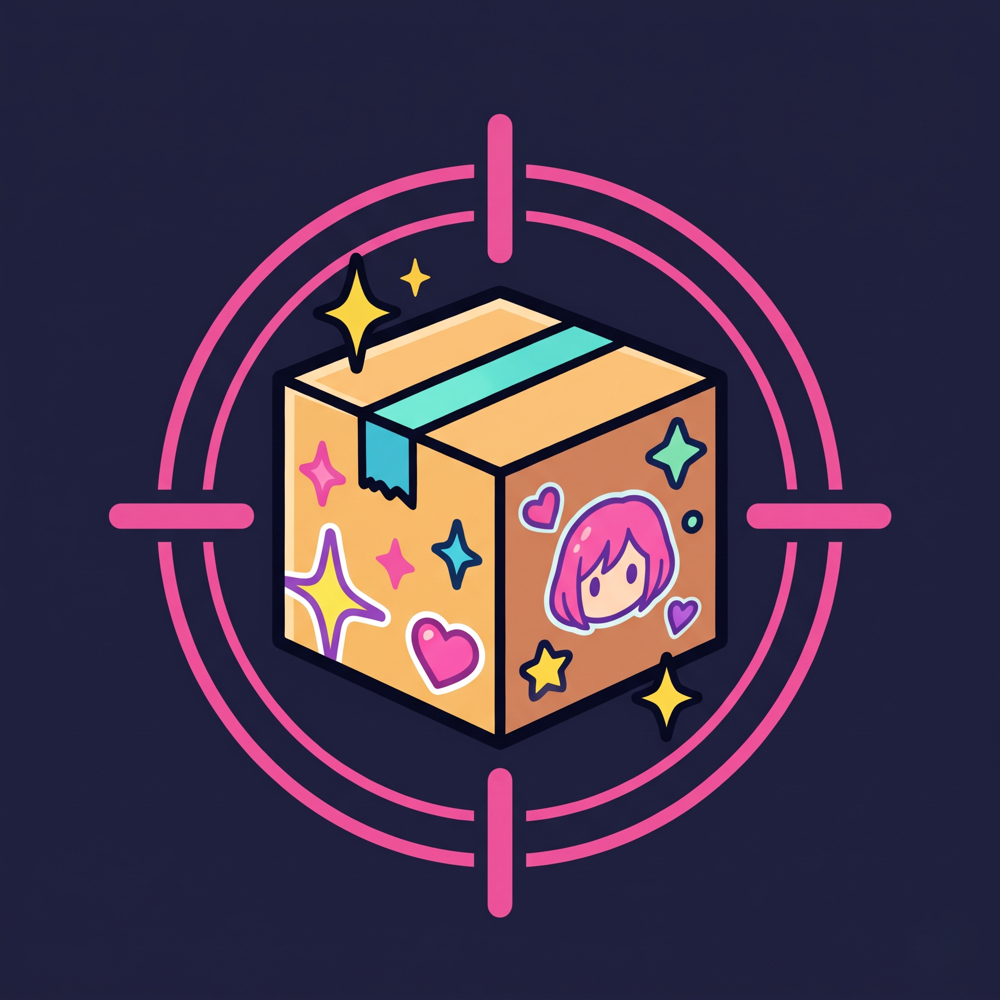
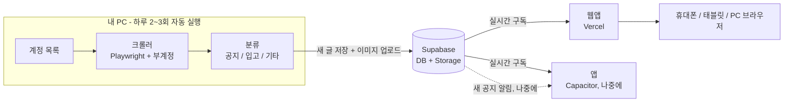

# 002 굿즈레이더



흩어져 있는 오타쿠 굿즈 상점들의 **입고 소식과 공지**를 한 화면에 모아 보여주는 서비스입니다.

> 상태 (2026-11-23): 분류기, Supabase DB, 크롤러(팔로잉 피드 감시, 작업 스케줄러 15분마다), 웹 화면(로컬) 완성.
> 다음: 배포(Vercel), 여러 브라우저 확인.

## 목적

굿즈샵, 가챠샵, 쿠지샵은 지역마다 흩어져 있고, 각자 인스타그램이나 네이버 스마트스토어로 소식을 올립니다.
그래서 **언제 어느 매장에 어떤 물건이 입고되는지** 알려면 매장 계정을 하나하나 찾아봐야 합니다.
이 서비스는 그 소식을 자동으로 모아 한곳에서 보여줍니다.

**우선순위**
1. **최우선:** 각 매장 인스타그램의 **피드 게시물과 릴스**에 올라오는 입고 소식·공지를 모아서 보여주기
2. 그다음: 키워드·작품 알림, 매장 지도
3. 나중에: 네이버 스마트스토어 등 다른 채널, 매장 직접 등록, 사용자 제보

릴스는 본문, 올린 시각, 대표 이미지(커버)를 수집합니다. 동영상 속 음성이나 자막 내용은 수집하지 않습니다.

## 브랜드

- **서비스 이름:** 굿즈레이더
- **로고:** [assets/logo.png](assets/logo.png) (원본 2048px). 조준선 안의 굿즈 상자.
- **대표색:** 로고 이미지에서 추출한 두 가지 색

| 이름 | 색상 코드 | 미리보기 | 쓰임 |
|---|---|---|---|
| 레이더 네이비 (배경) | `#20203E` |  | 로고 배경, 어두운 배경 |
| 레이더 핑크 (강조) | `#EB5499` |  | 로고 조준선, 버튼·선택 표시 등 강조 |

- **아이콘 만들기:** 로고를 바꾸면 `assets/logo.png`를 교체하고 `powershell -ExecutionPolicy Bypass -File scripts/make-icons.ps1` 실행
  - 파비콘(32px)과 머리글 로고(64px)는 모서리를 둥글게 자름
  - 아이폰(180px), 안드로이드(192·512px) 아이콘은 정사각형 그대로 (기기가 알아서 모양을 입힘)

## 경쟁 서비스 분석 (2026-11-23 조사)

**인스타그램 입고 소식을 자동으로 모아 주는 서비스는 찾지 못했습니다.** 비슷한 서비스는 모두 매장이 직접 올리거나 사용자가 제보하는 방식입니다.

### 굿즈·쿠지 정보 (직접 경쟁)

| 서비스 | 하는 일 | 입고 정보를 얻는 방법 | 배울 점 |
|---|---|---|---|
| [쿠지도](https://play.google.com/store/apps/details?id=com.kujido.app) | 전국 쿠지샵 지도, 실시간 재고, 재고 알림, 매장 재고 문의 | 매장이 직접 갱신 | 지도 + 재고 알림. 가장 가까운 경쟁 서비스 |
| [애니웨이](https://aniway.kr/) | 굿즈·가챠·쿠지 판매, 앱 소개에 오프라인 매장 입고·덕스타그램·팝업 | 확인 못 함 | 덕질 정보 + 판매를 한 앱에 묶는 구조. 웹사이트는 판매 중심 |
| [굿즈x굿즈](https://play.google.com/store/apps/details?id=com.goodsxgoods&hl=ko) | 쿠지 발매일, 중고 시세, 커뮤니티 | 커뮤니티 | 발매일 캘린더 |
| [굿즐리](https://apps.apple.com/us/app/%EA%B5%BF%EC%A6%90%EB%A6%AC/id6759715905) | 내 위치 주변 5km 굿즈 스팟 지도 | 사용자 직접 등록 | 위치 기반 탐색 |

### 정보 모아보기 화면·기능 참고 (팝업스토어)

| 서비스 | 배울 점 |
|---|---|
| [팝플리](https://apps.apple.com/qa/app/%ED%8C%9D%ED%94%8C%EB%A6%AC/id6502668733) | 장소·일정·사진·지도를 카드로 정리, 추천 목록 |
| [팝앤팝](https://apps.apple.com/kr/app/%ED%8C%9D%EC%95%A4%ED%8C%9D/id6480459320) | 지도 검색, 오픈·종료 알림 |
| 팝팡 | 키워드 알림, 캘린더 |
| [팝가](https://apps.apple.com/us/app/%ED%8C%9D%EA%B0%80-%ED%8C%9D%EC%97%85%EC%8A%A4%ED%86%A0%EC%96%B4-%EC%A0%95%EB%B3%B4-%EC%8B%A4%EC%8B%9C%EA%B0%84-%EB%9E%AD%ED%82%B9/id6742811367?l=ko) | 실시간 랭킹, 웨이팅 확인 |

### 해외

| 서비스 | 내용 |
|---|---|
| [ガチャマニア](https://apps.apple.com/jp/app/%E3%82%AC%E3%83%81%E3%83%A3%E3%83%9E%E3%83%8B%E3%82%A2-%E3%82%AC%E3%83%81%E3%83%A3%E5%B0%82%E7%94%A8sns-%E3%83%9E%E3%83%83%E3%83%97%E3%81%8B%E3%82%89%E5%A0%B4%E6%89%80%E3%82%92%E6%8E%A2%E3%81%9B%E3%82%8B%E3%82%A2%E3%83%97%E3%83%AA/id6446389775) (일본) | 가챠 목격 정보를 사용자가 지도에 올리는 SNS |
| [#C-pla 공식 앱](https://appmatch.jp/6450071897-2/) (일본) | 가챠 체인점 앱. 리뷰에 "재고·입고 정보가 부족하다"는 불만 → **입고 정보 수요의 근거** |
| [Restock Alerts](https://apps.apple.com/us/app/restock-alerts/id1641014901) (미국) | 온라인 쇼핑몰 상품 페이지를 감시해 재입고 알림. SNS 소식은 다루지 않음 |

### 우리 서비스에 적용할 점

1. **차별점:** 매장이 아무것도 하지 않아도, 이미 올리는 인스타그램 글이 자동으로 모인다.
2. **꼭 넣을 기능:** 키워드·작품 알림 (예: "코난 가챠 입고되면 알림"), 매장 지도, 매장별 보기
3. **나중에 고려:** 매장이 직접 정보를 보완하는 기능 (쿠지도 방식), 사용자 제보
4. **할 일:** 만들기 전에 쿠지도와 애니웨이를 직접 써보고 정확도·속도·불편한 점 확인

## 요구사항

| 구분 | 내용 |
|---|---|
| 출시 형태 | **웹사이트 먼저**, 같은 코드로 나중에 **앱(iOS/Android)** 출시 |
| 크로스 브라우징 | 주요 브라우저에서 똑같이 동작 (아래 [지원 브라우저](#지원-브라우저)) |
| 반응형 | 휴대폰, 태블릿, PC 화면 크기에 맞게 배치 |
| 실시간 갱신 | 새 공지가 들어오면 **새로고침 없이** 화면에 나타남 |
| 수집 대상 | 인스타그램 공개 계정의 게시물 (공지, 입고 소식) |

## 핵심 결정

### 1. 크롤링은 내 PC에서, 데이터는 클라우드 DB에

- 인스타그램은 로그인 없이 자동 접근하면 바로 차단합니다 (HTTP 429 확인).
- 그래서 **부계정으로 로그인한 브라우저**로 크롤링해야 하고, 이 로그인 상태는 내 PC 밖으로 내보내지 않습니다.
- 크롤링 결과는 **클라우드 DB**에 저장하고, 웹과 앱은 둘 다 이 DB에서 데이터를 받습니다.

### 2. 클라우드 DB: Supabase (추천)

이전 설계(결과 JSON을 GitHub에 push → Vercel 재배포)는 아래 이유로 바꿉니다.

| 요구사항 | GitHub JSON 방식 | **Supabase 방식** |
|---|---|---|
| 새로고침 없는 갱신 | 몇 분마다 파일을 다시 확인해야 함 (느림, 낭비) | **실시간 구독**: DB에 새 글이 들어오는 즉시 화면에 전달 |
| 앱에서 데이터 받기 | 웹사이트 주소의 파일을 읽어야 함 | 웹과 앱이 **같은 API**를 사용 |
| 이미지 저장 | 저장소에 이미지가 계속 쌓임 | **Storage**(파일 저장소)에 따로 저장 |
| 새 공지 푸시 알림 (앱) | 어려움 | DB 변경을 계기로 알림 보내기 가능 |
| 비용 | 0원 | 무료 요금제로 시작 가능 |

- Supabase = PostgreSQL DB + 실시간 구독 + 파일 저장소 + API를 한 번에 제공하는 서비스입니다.
- 무료 요금제는 오래 사용하지 않으면 일시정지될 수 있는데, 크롤러가 하루 여러 번 쓰기 때문에 문제가 되지 않을 것으로 봅니다. 정확한 무료 한도와 조건은 가입 전에 다시 확인합니다.
- 대안: Firebase (Google). 기능은 비슷하지만 SQL DB가 아니라서, 계정별·기간별로 조회하기는 Supabase가 더 쉽습니다.

### 3. 웹앱을 먼저 만들고, 앱은 같은 코드를 감싸서 출시

- **React + Vite**로 웹앱을 만듭니다 (001 환율 계산기와 같은 도구).
- **PWA**(홈 화면에 설치되는 웹앱)를 먼저 지원합니다.
- 앱스토어 출시는 **Capacitor**로 같은 웹 코드를 iOS/Android 앱으로 감쌉니다. 앱 출시는 웹 서비스가 안정된 뒤에 따로 기획합니다.
- 그래서 처음부터 **앱에서도 문제없는 방식**으로 만듭니다 (아래 [앱 출시를 위한 설계 규칙](#앱-출시를-위한-설계-규칙)).

## 전체 구조



## 데이터 설계 (Supabase)

### `accounts` 테이블: 모을 계정

| 컬럼 | 형식 | 설명 |
|---|---|---|
| `username` | 텍스트, 기본키 | 인스타그램 아이디 (예: `shirostore_hongdae`) |
| `display_name` | 텍스트 | 매장 이름 (예: 시로상점). 아이디와 다를 수 있음 (kuji.run = 토이아일랜드) |
| `extra_keywords` | 텍스트 목록 | 기본 규칙 외에 이 매장만 쓰는 표현 (필요할 때만) |
| `account_type` | 텍스트 | `굿즈샵` / `콜라보카페` (애니메이트 카페처럼 입고가 아니라 행사를 올리는 계정) |
| `fixed_hashtags` | 텍스트 목록 | 이 매장이 모든 글에 붙이는 해시태그 (작품 추출에서 제외. 예: 꼬꼬굿즈의 `#치이카와`) |
| `crawl_interval_hours` | 숫자 | 수집 간격. 많이 올리는 매장은 짧게 |
| `active` | 참/거짓 | 수집 중인지 |
| `last_crawled_at` | 시각 | 마지막 수집 시각 |
| `last_error` | 텍스트 | 마지막 실패 사유 |

### `branches` 테이블: 매장 지점

한 계정이 여러 지점을 운영하는 경우가 있습니다 (스페이스우라라 홍대점·대구점, 꼬꼬굿즈 1·2호점, 애니메이트 카페 홍대·부산·잠실).

| 컬럼 | 형식 | 설명 |
|---|---|---|
| `id` | 숫자, 기본키 | |
| `account` | 텍스트 | `accounts.username` 참조 |
| `name` | 텍스트 | 지점 이름 (예: 홍대점, 대구동성로스파크점) |
| `aliases` | 텍스트 목록 | 본문에서 이 지점을 가리키는 표현 (예: `1호점`, `[홍대점]`) |
| `region` | 텍스트 | 지역 (홍대, 대구, 부산, 평택 …). 지역 필터용 |
| `address` | 텍스트 | 주소. 지도용 |

지점이 하나인 매장도 지점 1개로 등록합니다. 그래서 `accounts`의 `region`, `address`는 지점 쪽으로 옮깁니다.

### `posts` 테이블: 수집한 게시물

| 컬럼 | 형식 | 설명 |
|---|---|---|
| `id` | 텍스트, 기본키 | 인스타그램 게시물 코드 (예: `Df87FhwEZ6f`). 중복 저장 방지 |
| `account` | 텍스트 | `accounts.username` 참조 |
| `category` | 텍스트 | `입고` / `콜라보·팝업` / `이벤트·안내` / `기타` |
| `goods_type` | 텍스트 목록 | `쿠지` / `가챠` / `피규어` / `굿즈` (입고 글만, 여러 개 가능) |
| `works` | 텍스트 목록 | 작품 이름 (작품 사전 기준. 예: `나의히어로아카데미아`) |
| `branches` | 숫자 목록 | 해당 지점 (`branches.id`). 본문에 지점 언급이 없으면 계정의 전체 지점 |
| `starts_at` | 시각 | 쿠지·행사 시작 일시 (본문에 있으면) |
| `ends_at` | 시각 | 행사 종료 일시 (콜라보 기간처럼 기간이 있으면) |
| `media_type` | 텍스트 | `사진` / `여러 장` / `릴스` |
| `pinned` | 참/거짓 | 고정 글 여부 |
| `caption` | 텍스트 | 본문 전체 |
| `posted_at` | 시각 | 인스타그램에 올린 시각 |
| `image_path` | 텍스트 | Storage에 저장한 대표 이미지 경로 |
| `url` | 텍스트 | 인스타그램 원문 링크 |
| `first_seen_at` | 시각 | 처음 수집한 시각 |

- **권한:** 웹과 앱은 **읽기만** 가능합니다 (공개 키). 쓰기는 내 PC 크롤러만 할 수 있습니다 (비밀 키, PC에만 보관).
- **이미지:** 인스타그램 이미지 주소는 시간이 지나면 만료되므로 대표 이미지 1장을 Storage에 저장합니다.
- **보관 기간:** 90일 (무료 용량 관리). 이벤트·안내 글은 고정이 풀려도 남깁니다.

### `works` 테이블: 작품 사전

작품별 보기와 알림의 기준입니다. 해시태그만으로는 부족해서(아래 분석 4번) 본문에서도 작품 이름을 찾을 수 있게 사전으로 관리합니다.

| 컬럼 | 형식 | 설명 |
|---|---|---|
| `name` | 텍스트, 기본키 | 대표 이름 (예: `나의히어로아카데미아`) |
| `aliases` | 텍스트 목록 | 다른 표기 (예: `나히아`, `히로아카`, `나의 히어로 아카데미아`) |

- 처음에는 수집한 글에 자주 나온 작품 100여 개로 시작하고, 사전에 없는 해시태그는 "새 작품 후보"로 모아 두었다가 직접 추가합니다.

## 매장 계정 분석 (2026-11-23, 매장 9곳 × 최근 12개)

| 매장 | 입고 글 형식 | 고정(📌) 글 | 특징 |
|---|---|---|---|
| 시로상점 (`shirostore_hongdae`) | `[ 시로상점 입고안내 ]` | 팝업 안내, 가챠 시스템 안내 | 7시간 동안 10개 올림 |
| 유미상점 (`umeshop__o`) | `[ 유미상점 입고 소식 ]` (괄호 없을 때도) | 1주년 이벤트, 매장 위치 릴스 | 스마트스토어 링크 함께 |
| 원피규어 (`onefigure_hongdae`) | `🫧캡슐 가챠 입고🫧` / `✨쿠지 입고✨` / `🌈굿즈 입고` | 수험생 할인 이벤트 | 가챠·쿠지·굿즈를 스스로 구분 |
| 오타쿠플래닛 (`o_takuplanet`) | "○○ 쿠지 상품이 입고 되었습니다. 시작 날짜: 10월 25일 오후 2시" | 매장 소개, 포토존 릴스 | 릴스 대부분이 일상·굿즈깡 영상 |
| 토이아일랜드 (`kuji.run`, 평택) | "❤️‍🔥신상 피규어 입고❤️‍🔥" + 상품 목록 | 없음 | 아이디 ≠ 매장 이름, 본문 없는 글 있음 |
| 스페이스우라라 (`space_urara`) | `⭐○○ 굿즈 입고!⭐`, 쿠지는 `⭐몬스터 주식회사 제일복권⭐` ("입고" 없음) | 없음 | **지점 2곳**(홍대, 대구 동성로). 모든 글 끝에 주소와 "신상품이 입고 될 예정" 문구 반복 |
| 애니메이트 카페 (`animatecafe_korea`) | 입고 글 없음. `【○○×애니메이트 카페】 콜라보 기간 12월18일~1월19일` | 없음 | **콜라보카페 행사 계정.** 지점 3곳(홍대, 부산, 잠실롯데). 예약 오픈 일시, 사과·교환 공지 |
| THE꼬꼬굿즈 (`thecocogoods`) | `꒰ა ♡ ໒꒱THE꼬꼬굿즈/ 오프라인샵 / 입고상품안내꒰ა ♡ ໒꒱` | 수능 이벤트, 극장판 이벤트 | **1·2호점.** 상품과 상관없이 모든 글에 `#치이카와 #우사기` 고정 해시태그. 18분 동안 6개 올림 |
| 제이에스 스토어 (`jsstore_hongdae`) | `🎀제이에스 스토어 입고 안내 ❣` | 없음 | **해시태그 없음.** 본문에 "케이온 굿즈가 입고 되었습니다"처럼 작품 이름. 2분 동안 4개 올림 |

**결론**
1. **굿즈샵 8곳 모두 "입고"를 씀** → 공통 키워드로 대부분 분류 가능. 단, 스페이스우라라 쿠지 글처럼 제목에 "입고"가 없고 상품 종류(`제일복권`)만 있는 경우도 있음 → 쿠지·가챠 키워드도 입고 신호로 봄
2. **반복 문구 주의.** 스페이스우라라는 모든 글에 "신상품이 입고 될 예정" 문구가 붙어서, 그대로 두면 어떤 글이든 입고로 잡힘 → **매장마다 반복되는 문구를 먼저 지우고** 분류
3. **고정 글 ≠ 공지.** 매장 소개, 위치, 이벤트를 고정하는 경우가 많음 → "공지" 대신 **"이벤트·안내"**
4. **해시태그만으로는 작품을 알 수 없음.** 꼬꼬굿즈는 모든 글에 `#치이카와`를 붙이고, 제이에스 스토어는 해시태그가 없음 → **작품 사전으로 본문에서 작품 이름을 찾고**, 해시태그는 보조로 사용. 매장 고정 해시태그는 제외
5. **여러 지점을 운영하는 매장이 많음** (9곳 중 3곳) → 지점 테이블을 따로 두고, 본문에서 지점 이름(`[홍대점]`, `1 & 2호점`)을 찾아 연결
6. **콜라보카페는 다른 종류의 소식.** 입고가 아니라 행사 기간(시작~종료), 예약 오픈 일시가 핵심 → **"콜라보·팝업"** 분류를 따로 두고 기간을 저장
7. **쿠지·행사는 일시가 핵심 정보** → 시작·종료 일시를 뽑아 캘린더로 활용
8. **몰아서 올리는 매장이 많음** (꼬꼬굿즈 18분에 6개, 제이에스 2분에 4개, 시로상점 7시간에 10개) → 한 번에 최근 12개만 보이므로 매장별 수집 간격 조절이 필요

## 분류 규칙

위 분석을 바탕으로, 매장 공통 규칙을 먼저 적용하고 필요할 때만 매장별 설정을 더합니다.

### 0단계: 반복 문구 지우기

- 같은 매장의 최근 글 대부분(예: 70% 이상)에 똑같이 들어 있는 줄은 **매장 반복 문구**로 보고 분류 전에 지웁니다 (주소, "놀러오세요", "신상품이 입고 될 예정" 등).
- 원문은 그대로 저장하고, 지운 본문은 분류에만 씁니다.
- 지운 줄에서 지점 이름은 따로 확인합니다 (`[홍대점]`처럼 지점 정보가 반복 문구에 들어 있는 경우).

### 1단계: 분류 (`category`)

| 순서 | 분류 | 판단 기준 | 예 |
|---|---|---|---|
| 1 | **콜라보·팝업** | 계정 종류가 `콜라보카페`이거나, 본문에 `콜라보`, `콜라보 기간`, `팝업스토어`, `POP-UP` 포함 | 애니메이트 카페, 시로상점 대구 팝업 |
| 2 | **입고** | 본문에 `입고` 포함, 또는 첫 줄에 쿠지·가챠 키워드(`제일복권`, `이치방쿠지`, `가챠`) | 굿즈샵 8곳 모두 해당 |
| 3 | **이벤트·안내** | 고정 글이거나, 본문에 `이벤트`, `할인`, `휴무`, `영업시간`, `오픈`, `공지`, `안내`, `사과`, `교환` 포함 | 1주년 이벤트, 수능 할인, 교환 안내 |
| 4 | 기타 | 위에 해당하지 않음 (일상, 굿즈깡 릴스, 본문 없는 글) | 오타쿠플래닛 일상 릴스 |

- 입고를 이벤트·안내보다 먼저 판단합니다 (`입고안내`에 "안내"가 들어 있기 때문).
- 매장 소개 고정 글에 "리바이 굿즈가 많이 입고 되었다"처럼 입고가 섞인 경우 → 고정 글이고 매장 소개(주소·위치 포함)면 이벤트·안내로 우선 처리
- 규칙으로 판단이 애매한 글은 나중에 AI 분류를 붙이는 것도 검토 (지금은 규칙만)

### 2단계: 상품 종류 (`goods_type`, 입고 글만)

| 종류 | 본문 키워드 |
|---|---|
| 쿠지 | `쿠지`, `이치방쿠지`, `제일복권`, `아타리복권` |
| 가챠 | `가챠`, `캡슐` |
| 피규어 | `피규어`, `룩업`, `메가캣` |
| 굿즈 | 위에 해당하지 않는 입고 글 (아크릴, 캔뱃지, 인형 등) |

### 3단계: 작품 (`works`)

1. **본문에서 찾기 (주 방법):** 작품 사전의 이름·별칭이 본문에 나오면 그 작품으로 연결 (예: "케이온 굿즈가 입고" → 케이온)
2. **해시태그에서 찾기 (보조):** 매장 이름·지역 태그(`#홍대굿즈샵`)와 매장 고정 해시태그(`fixed_hashtags`)를 빼고 사전과 맞춰 봄
3. 사전에 없는 해시태그는 "새 작품 후보"로 모아 두었다가 직접 사전에 추가

### 4단계: 지점 (`branches`)

- 본문(반복 문구 포함)에서 지점 별칭(`[홍대점]`, `1 & 2호점`, `개최 매장 : 애니메이트 카페 부산점`)을 찾아 연결
- 지점 언급이 없으면 그 계정의 모든 지점으로 봄

### 5단계: 일시 (`starts_at`, `ends_at`)

- 시작: `시작 날짜 : 10월 25일 (일요일) 오후 2시`, `11월 21일 스타트`
- 기간: `11.21(토) ~ 11.22(일)`, `콜라보 기간 12월18일(금)~1월19일(화)` → 시작·종료 둘 다 저장
- 예약 오픈: `8월 31일(월) 18:00 온라인 예약 오픈` → 나중에 예약 알림에 활용
- 연도가 없으면 올린 날짜 기준으로 가장 가까운 미래 날짜로 판단 (12월 → 1월처럼 해가 바뀌는 기간 주의)

## 실시간 갱신 (새로고침 없이)

| 상황 | 동작 |
|---|---|
| 화면을 보고 있는데 새 글이 들어옴 | Supabase 실시간 구독으로 즉시 받아서, 목록 맨 위에 **"새 소식 N개"** 버튼 표시 → 누르면 목록에 추가 (읽던 위치가 갑자기 밀리지 않게) |
| 화면이 맨 위에 있을 때 | 바로 목록에 추가하고 살짝 강조 표시 |
| 다른 탭에 있다가 돌아옴 | 화면이 다시 보일 때 빠진 글이 있는지 한 번 더 확인 |
| 인터넷이 끊겼다 다시 연결됨 | 자동으로 다시 구독하고 빠진 글 확인 |
| 실시간 연결이 안 되는 환경 | 5분마다 새 글 확인으로 대체 |
| "마지막 업데이트" 시각 | 크롤러가 마지막으로 돌았던 시각을 표시 (PC가 꺼져 있었는지 알 수 있게) |

## 반응형 화면

모바일 화면을 먼저 만들고, 넓은 화면으로 확장합니다.

| 화면 폭 | 기기 예 | 배치 |
|---|---|---|
| ~599px | 휴대폰 | 카드 1열, 하단 탭 바 (입고 / 이벤트·안내 / 전체) |
| 600~1023px | 태블릿, 접는 폰 | 카드 2열, 상단 탭 |
| 1024px~ | PC | 왼쪽에 필터(지역, 매장, 상품 종류) + 오른쪽에 카드 2~3열 |

```
휴대폰                          PC
┌───────────────────┐   ┌────────────┬─────────────────────────────┐
│ 굿즈 입고 모아보기 ⟳│   │ 지역        │ 굿즈 입고 모아보기  업데이트 18:00│
│ 업데이트 18:00     │   │ ● 전체 ○ 홍대│ [입고] [이벤트·안내] [전체]     │
│ [쿠지][가챠][피규어]│   │ 매장        │ ┌────────┐ ┌────────┐ ┌──────┐ │
│ [새 소식 2개 ↑]    │   │ ☑ 시로상점  │ │🖼 카드 │ │🖼 카드 │ │🖼 카드│ │
├───────────────────┤   │ ☑ 유미상점  │ └────────┘ └────────┘ └──────┘ │
│ 🖼 원피규어 · 쿠지  │   │ 상품 종류   │ ┌────────┐ ┌────────┐          │
│ 제일복권 드래곤볼   │   │ ☑ 쿠지 ☑ 가챠│ │🖼 카드 │ │🖼 카드 │          │
│ #드래곤볼 · 11.20  │   │            │ └────────┘ └────────┘          │
├───────────────────┤   └────────────┴─────────────────────────────┘
│ 🖼 유미상점 · 굿즈  │
├───────────────────┤
│ 입고 │ 이벤트 │ 전체 │  ← 하단 탭 바
└───────────────────┘
```

- 카드: 대표 이미지, 매장 이름, 상품 종류(쿠지·가챠·피규어·굿즈), 작품 태그, 올린 날짜, 쿠지 시작 일시(있으면), 본문 앞부분 3줄, 원문 링크
- 상단 칩으로 상품 종류 빠르게 거르기 (쿠지 / 가챠 / 피규어 / 굿즈)
- 작품 태그를 누르면 그 작품의 입고 글만 보기
- 카드를 누르면 본문 전체 보기, 그 안에 "인스타그램에서 보기" 버튼
- 글자 크기는 고정 픽셀 대신 상대 단위(rem)를 써서 휴대폰 글자 크기 설정을 따름
- 다크 모드 지원

## 지원 브라우저

| 브라우저 | 지원 버전 | 비고 |
|---|---|---|
| Chrome (PC, Android) | 최근 2개 버전 | |
| Edge | 최근 2개 버전 | |
| Safari (Mac) | 16 이상 | |
| **Safari (iPhone, iPad)** | iOS 16 이상 | 국내 아이폰 사용자, 가장 많이 차이 나는 브라우저 |
| **삼성 인터넷** | 최근 2개 버전 | 국내 안드로이드 사용자 비중 큼 |
| Firefox | 최근 2개 버전 | |
| 인스타그램·카카오톡 내장 브라우저 | 기본 동작 보장 | 링크를 공유받아 여는 경우가 많음 |

지원하지 않음: Internet Explorer

**크로스 브라우징을 지키는 방법**
- Vite 빌드 대상을 위 브라우저 목록에 맞춤 (`build.target`, Browserslist)
- 브라우저마다 다른 기능은 쓰기 전에 지원 여부 확인 (caniuse.com 기준)
- iOS Safari 주의점 반영: 화면 높이(`100dvh`), 노치 영역(`safe-area-inset`), 입력칸 확대 방지(글자 16px 이상), 스크롤 튕김
- 배포 전 확인: Playwright로 Chromium·WebKit(Safari 엔진)·Firefox 자동 화면 테스트 + 실제 아이폰·갤럭시에서 직접 확인

## 앱 출시를 위한 설계 규칙

나중에 Capacitor로 앱을 만들 때 다시 고치지 않도록, 웹앱을 처음부터 아래처럼 만듭니다.

| 규칙 | 이유 |
|---|---|
| 서버에서 화면을 만들지 않고, 브라우저에서 API로 데이터를 받아 그림 (SPA) | 앱은 웹 파일을 기기 안에 넣고 실행하기 때문 |
| 데이터는 모두 Supabase API로 받음 | 웹과 앱이 같은 데이터 사용 |
| 페이지 이동은 앱 안에서 처리 (해시 또는 메모리 라우팅도 가능하게) | 앱에서는 웹 주소창이 없음 |
| 누르는 영역 최소 44×44px | 손가락 터치 기준 (Apple, Google 권장) |
| 노치·홈 바 영역 피하기 (`safe-area-inset`) | 아이폰 노치, 안드로이드 제스처 바 |
| 외부 링크(인스타그램 원문)는 새 창 또는 앱 밖 브라우저로 열기 | 앱 심사 기준 |
| 오프라인일 때 마지막으로 받은 목록 보여주기 | 앱 사용 경험 |
| 푸시 알림은 앱 출시 때 추가 (웹은 선택) | iOS 웹 푸시는 홈 화면에 설치한 경우에만 가능 |

## 크롤러 설계 (내 PC)

| 항목 | 내용 |
|---|---|
| 실행 | Windows 작업 스케줄러로 매장 영업시간(약 10시~22시)에 1시간마다 깨어나, **수집 간격이 지난 매장만** 수집 |
| 매장별 간격 | 기본 6시간. 많이 올리는 매장(시로상점: 7시간에 10개)은 2시간. 수집했을 때 **12개 전부가 새 글이면** 놓친 글이 있을 수 있으므로 다음 간격을 자동으로 줄임 |
| 순서 | `accounts` 테이블에서 수집할 계정 목록 받기 → 계정마다 최근 게시물 약 12개 수집 → 분류 → 새 글만 DB에 저장 + 이미지 업로드 |
| 간격 | 계정 사이 1~3분 무작위 대기, 스크롤로 더 불러오지 않음 |
| 로그인 | 부계정, 로그인 상태는 `%LOCALAPPDATA%\insta-notice\profile`에만 저장 (OneDrive 밖) |
| 비밀 키 | Supabase 쓰기 키는 PC의 `.env` 파일에만 저장, Git에 올리지 않음 |
| 실패 처리 | 바로 재시도하지 않음. 실패 사유를 `accounts.last_error`에 기록 |
| 멈춤 조건 | 로그인이 풀렸거나 3번 연속 실패하면 멈추고 알림 |

## 위험과 한계

| 위험 | 대응 |
|---|---|
| 인스타그램 이용약관상 자동 수집 금지 | 본계정 대신 부계정 사용, 요청 횟수 최소화 |
| 부계정 제한·정지 | 새 부계정으로 다시 로그인 |
| 인스타그램 화면 구조 변경 | 크롤러 수정 필요. 실패 알림으로 빨리 알아챔 |
| 내 PC가 꺼져 있으면 수집 안 됨 | "마지막 업데이트" 표시. 나중에 클라우드 서버로 옮기는 것 검토 |
| **앱스토어 심사** | 다른 서비스의 콘텐츠를 수집해 보여주는 앱은 심사에서 거절될 수 있음. 출시 전에 심사 기준과 권리 문제를 따로 확인 |
| 최근 12개 안에 공지가 묻힐 수 있음 | 대부분 공지는 고정되므로 큰 문제는 아님 |
| 스토리 하이라이트 공지 | 수집 안 함 (범위 밖) |

## 개발 단계 (설계 확정 후 진행)

1. Supabase 프로젝트 만들기, 테이블·권한 설정
2. 크롤러: 여러 계정 수집 + 분류 + DB 저장 + 이미지 업로드
3. 웹앱 화면: 반응형 카드 목록, 탭, 계정 필터
4. 실시간 갱신: 구독, "새 공지 N개" 버튼, 연결 끊김 처리
5. 크로스 브라우징 테스트 (Chromium·WebKit·Firefox + 실제 기기)
6. Vercel 배포
7. 크롤러 자동 실행 등록 + 실패 알림
8. PWA (홈 화면 설치)
9. (나중에) Capacitor 앱 + 푸시 알림 + 앱스토어 출시 기획

## 정해야 할 것

- [ ] 클라우드 DB: Supabase (추천) / Firebase
- [ ] 모을 계정 목록 (지금 9개: 시로상점, 유미상점, 원피규어, 오타쿠플래닛, 토이아일랜드, 스페이스우라라, 애니메이트 카페, THE꼬꼬굿즈, 제이에스 스토어). 매장별 지점·주소 확인 필요
- [ ] 콜라보카페(애니메이트 카페 등)를 입고 소식과 같은 화면에 넣을지, 따로 "행사" 화면으로 뺄지
- [x] 보여줄 범위: **입고 + 공지** 둘 다 (입고 소식이 핵심). 탭으로 나눔
- [ ] 첫 화면 기본 탭: 입고 / 공지 / 전체
- [ ] 웹사이트 공개 범위: 나만 보기 / 누구나 보기 (로그인 기능 필요 여부)
- [ ] 크롤링 시간과 횟수 (기본안: 하루 3회)
- [ ] 실패 알림 방법: 이메일 / 카카오톡 / 기타
- [ ] 서비스 이름
